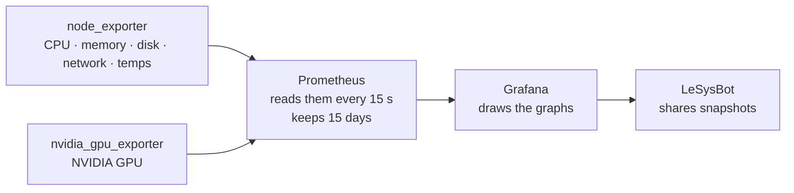

# Dashboards

Graphs of your machine over time — CPU, memory, disk, network, temperatures and
GPU — in Grafana at:

```
http://localhost:3000
```

The installer set this up. If something else already used port 3000, Grafana is
on the next free one — `lesysbot dashboard` prints the address.

Log in with the username and password you chose during setup (`admin` by
default). They're saved in `~/.lesysbot/grafana.env`, so you can always look
them up — see [Forgot the password?](#forgot-the-password). The dashboard is in
the **LeSysBot** folder.

## How it works



Four standard programs run in Docker, next to LeSysBot rather than inside it:

- **Exporters** read your hardware. `node_exporter` covers CPU, memory, disk,
  network and temperatures; `nvidia_gpu_exporter` covers an NVIDIA card. AMD
  GPUs need no exporter.
- **Prometheus** collects their readings every 15 seconds and keeps 15 days of
  history.
- **Grafana** draws the graphs from Prometheus.
- **LeSysBot** talks to Grafana only to [share a snapshot](#share-a-snapshot),
  using the login in `~/.lesysbot/grafana.env`. The bot works without the
  dashboard, and the dashboard keeps recording when the bot is stopped.

Everything lives in `~/.lesysbot/dashboard`, listens on `127.0.0.1` only, and
needs no `sudo`.

Each `lesysbot dashboard start` checks your hardware first — which temperature
sensors exist, whether `nvidia-smi` works — and writes a dashboard with only the
panels your machine can fill. That's why there's nothing to configure, and why
an empty panel means something is actually wrong.

## Start and stop

```bash
lesysbot dashboard start
lesysbot dashboard stop
```

It needs Docker. Everything listens on `127.0.0.1` only, and nothing needs
`sudo`.

If another program already uses port 3000, Grafana moves to the next free port
(3001, 3002, …) and `start` prints where it went. To pick the port yourself:

```bash
lesysbot dashboard start --grafana-port 3300
```

The choice is saved, so later starts reuse it.

<details>
<summary><b>Don't have Docker yet?</b></summary>

Install [Docker Engine](https://docs.docker.com/engine/install/) for your
distribution, then let your user run it without `sudo`:

```bash
sudo usermod -aG docker $USER      # then log out and back in
docker compose version             # should print v2.x
lesysbot dashboard start
```

</details>

## What's on it

One dashboard, **System Overview**: CPU, memory, disk, network per interface,
temperatures and NVIDIA/AMD GPU. Panels your hardware can't fill are left out.

## Forgot the password?

LeSysBot saved it:

```bash
grep PASSWORD ~/.lesysbot/grafana.env
```

If Grafana says that password is wrong, someone changed it inside Grafana, and
Grafana kept its own copy. Run setup again and enter the password you want:

```bash
lesysbot setup
```

Keep your existing settings when it asks. At the Grafana login step, setup sets
the running Grafana to the password you enter and saves it for LeSysBot.

After 5 wrong tries in 5 minutes, Grafana refuses every login for that user,
even the right one, until 5 minutes pass. If the right password keeps failing,
stop trying and wait 5 minutes.

If you change the password in Grafana's own settings later, put the same one in
`~/.lesysbot/grafana.env` too, or snapshot sharing stops working.

## Share a snapshot

Ask the bot:

```
You: share me the dashboard for a day
Bot: 📊 Dashboard shared — expires in 1d:
     https://snapshots.raintank.io/dashboard/snapshot/…
```

Anyone with the link can see a copy of your graphs. Links can last from an hour
to a month. Say *"list my shared dashboards"* to see them, and *"delete snapshot
1"* to take one down (a cached copy may linger for up to an hour).

## Change it

```bash
lesysbot dashboard customize
```

This saves a copy of the dashboard to `~/.lesysbot/dashboard/dashboard.json`.
Edit that file, then apply it:

```bash
lesysbot dashboard start
```

Grafana shows the change within 30 seconds. From now on your copy is used
instead of the automatic one, and upgrades never overwrite it.

To build it in Grafana instead: edit the dashboard there, then **Export → Save
to file** (leave *Export for sharing externally* off) and save the JSON over
`~/.lesysbot/dashboard/dashboard.json`. Edits you only save inside Grafana are
lost the next time the dashboard starts.

Want the automatic one back?

```bash
lesysbot dashboard reset       # your copy is kept as dashboard.json.bak
lesysbot dashboard start
```

To see which one you're using, and where Grafana is, run `lesysbot dashboard`
with no action.

Ports, `.env` settings and the stack's internals are in
[`dashboard/README.md`](../dashboard/README.md). Empty panels? See
[Troubleshooting](troubleshooting.md#dashboards).
